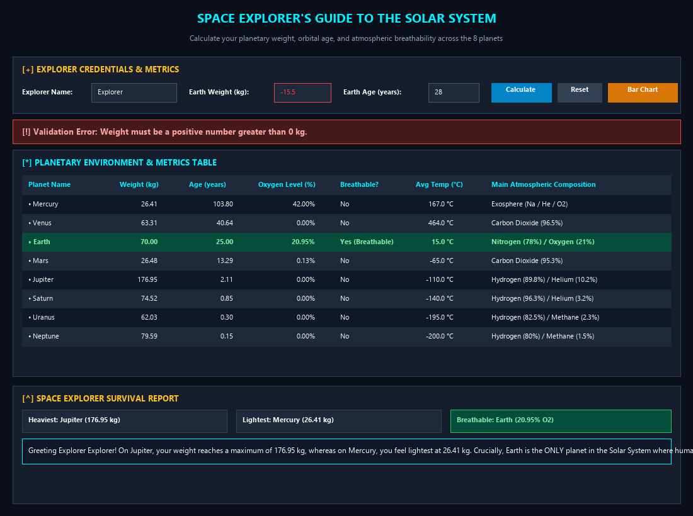
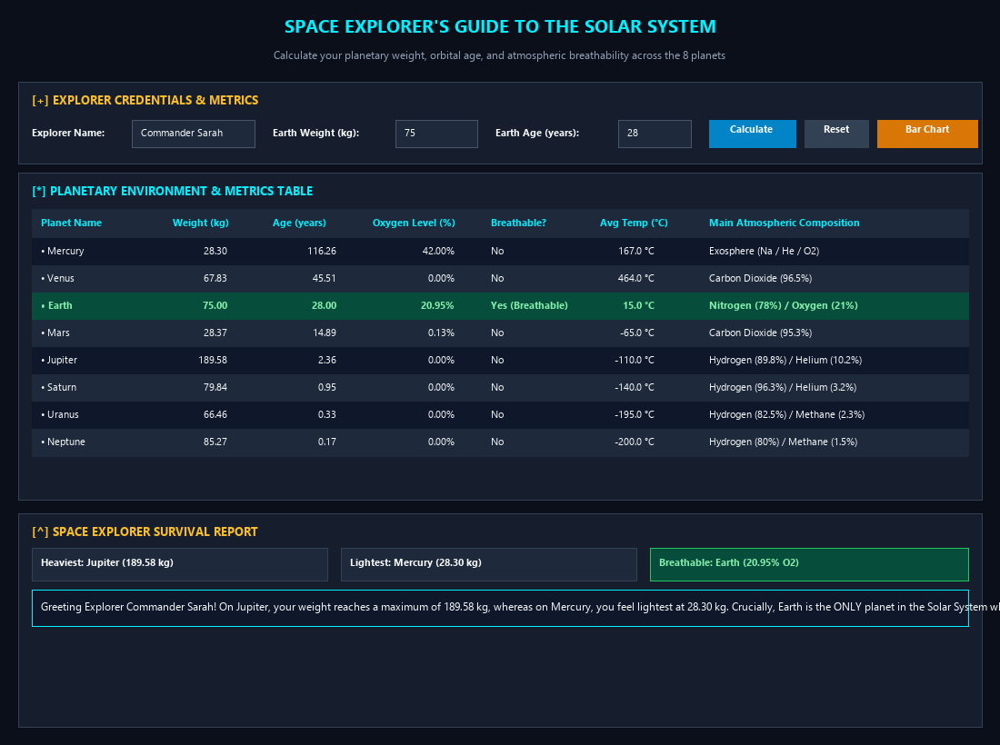
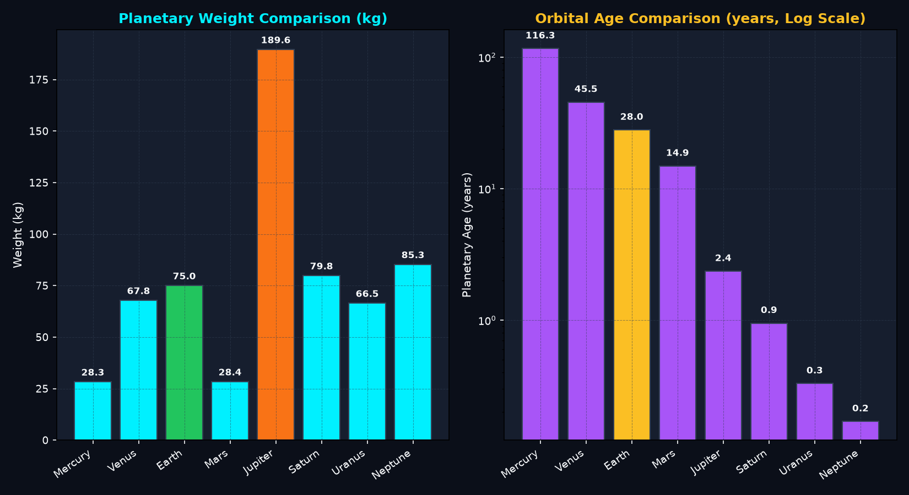

# PROJECT REPORT: Planet Weight, Age and Breathability Calculator
## A Space Explorer's Guide to the Solar System

---

## 1. Project Title
**Planet Weight, Age and Breathability Calculator: A Space Explorer's Guide to the Solar System**

---

## 2. Introduction & Astronomy Background
Human space exploration is expanding beyond Earth's orbit. As astronauts prepare for future interplanetary missions to Mars and beyond, understanding how different cosmic environments affect human physiology is critical.

Every planet in our Solar System possesses unique physical, orbital, and atmospheric properties:
- **Surface Gravity ($g$)**: Dictated by a planet's mass and radius ($g = G \cdot M / r^2$). Heavy planets like Jupiter exert strong gravitational pulls, increasing perceived human weight, while smaller bodies like Mercury or Mars exert less gravity, reducing perceived weight.
- **Orbital Period ($T$)**: The duration required for a planet to complete one full orbit around the Sun. Inner planets close to the Sun (e.g., Mercury, 88 Earth days) orbit rapidly, whereas distant outer planets (e.g., Neptune, ~165 Earth years) orbit slowly. Consequently, an explorer's age measured in planetary orbital years varies dramatically across the Solar System.
- **Atmospheric Composition & Pressure**: Human respiration requires an atmospheric oxygen ($\text{O}_2$) concentration between **$19.5\%$ and $23.5\%$** at standard sea-level atmospheric pressure (~1 bar). Planets with toxic carbon dioxide atmospheres (Venus, Mars), hydrogen/helium gas envelopes (Jupiter, Saturn), or extreme thermal/pressure conditions cannot sustain human life unaided.

This project implements a desktop application designed as a "Space Explorer's Guide", allowing users to input their Earth weight and age and instantly visualize their weight, age, oxygen levels, breathability, and average surface temperatures across all eight planets in the Solar System.

---

## 3. Objective
The primary objectives of this project are:
1. **Interactive Planetary Calculations**: Accurately calculate a person's weight and age on Mercury, Venus, Earth, Mars, Jupiter, Saturn, Uranus, and Neptune based on standard NASA planetary factsheets.
2. **Atmospheric Survival Evaluation**: Assess the breathability of each planet's atmosphere against human physiological limits ($19.5\% - 23.5\%\text{ O}_2$).
3. **Professional Dark Space UI**: Design an intuitive GUI using Python's `Tkinter` and `ttk` libraries featuring a dark navy/black "deep space" aesthetic, cyan/gold headings, color-coded table rows, and survival summary cards.
4. **Resilient Input Validation**: Validate all inputs (detecting non-numeric values, negative numbers, zeroes, empty fields, and unrealistic bounds) without application crashes.
5. **Visual Data Exploration**: Provide optional Matplotlib bar charts comparing weight and logarithmic age across planets.
6. **Decoupled Architecture**: Maintain strict separation between calculation/validation logic and user interface code to enable clean unit testing.

---

## 4. Technologies Used
- **Programming Language**: Python 3.13
- **GUI Framework**: Python Built-in `tkinter` and `tkinter.ttk` (No third-party UI framework required)
- **Data Visualization**: `matplotlib` (for bar charts) and `PIL` (Pillow for image processing and screenshot rendering)
- **Testing Framework**: Python `unittest` framework

---

## 5. Working & Methodology

### Architectural Design
The software follows a modular software architecture separating data, business logic, GUI components, and visual charts:

```
+-------------------------------------------------------------+
|                         main.py                             |
|              (Application Entry Launcher)                   |
+------------------------------+------------------------------+
                               |
                               v
+-------------------------------------------------------------+
|                       gui_app.py                            |
|    - Deep Space Theme Styling (Tkinter & TTK)              |
|    - Input Controls (Name, Weight, Age, Buttons)            |
|    - Inline Error Alert Banner                              |
|    - Styled TTK Treeview Table (Color-Coded Rows)           |
|    - Survival Summary Cards Panel                           |
|    - Matplotlib Popup Chart Integration                     |
+------------------------------+------------------------------+
                               |
                               v
+-------------------------------------------------------------+
|                     calculator_logic.py                     |
|    - validate_inputs()                                      |
|    - calculate_planet_weight()                              |
|    - calculate_planet_age()                                 |
|    - is_atmosphere_breathable()                             |
|    - calculate_all_planets()                                |
|    - get_survival_summary()                                 |
+------------------------------+------------------------------+
                               |
                               v
+-------------------------------------------------------------+
|                      planet_data.py                         |
|    - NASA Factsheet Data Dictionary (8 Planets)             |
|    - Baseline Physics & Physiology Constants                |
+-------------------------------------------------------------+
```

### Interface Design & Layout
1. **Title Header Banner**: Title text in bright cyan (`#00F0FF`) with a subtitle on a dark navy (`#0B0E14`) background.
2. **Explorer Input Panel**: Input fields for Explorer Name, Weight (kg), and Age (years). Contains "Calculate", "Reset", and "Bar Chart" action buttons. Pressing `Enter` automatically triggers calculation.
3. **Inline Error Alert Banner**: Displays highlighted validation errors in red (`#EF4444`) directly above the results table when inputs are invalid.
4. **Planetary Environment & Metrics Table**: A `ttk.Treeview` table displaying planet metrics. Earth's row is highlighted with emerald green background (`#064E3B`) and text (`#86EFAC`) for instant visual feedback.
5. **Survival Report Summary**: A card-style bottom panel summarizing the heaviest planet, lightest planet, and sole breathable sanctuary, along with a custom sentence for the explorer.

---

## 6. Formulae Used & Planetary Data Table

### Mathematical Formulae

1. **Planetary Weight ($W_{\text{planet}}$)**:
   $$W_{\text{planet}} = W_{\text{Earth}} \times \frac{g_{\text{planet}}}{g_{\text{Earth}}}$$
   *Where $g_{\text{Earth}} = 9.807 \text{ m/s}^2$.*

2. **Planetary Orbital Age ($A_{\text{planet}}$)**:
   $$A_{\text{planet}} = A_{\text{Earth}} \times \frac{T_{\text{Earth}}}{T_{\text{planet}}}$$
   *Where $T_{\text{Earth}} = 365.25 \text{ days}$ and $T_{\text{planet}}$ is orbital period in Earth days.*

3. **Atmospheric Breathability Condition**:
   $$\text{Breathable} = \begin{cases} \text{Yes}, & \text{if } 19.5\% \le \text{Oxygen \%} \le 23.5\% \\ \text{No}, & \text{otherwise} \end{cases}$$

### NASA Structured Planetary Data Reference

| Planet Name | Surface Gravity ($m/s^2$) | Orbital Period (Earth Days) | Oxygen Level ($\%$) | Main Atmospheric Composition | Avg Temp ($^\circ\text{C}$) | Breathable? |
| :--- | :---: | :---: | :---: | :--- | :---: | :---: |
| **Mercury** | 3.70 | 87.97 | 42.00%* | Exosphere (Sodium / Helium / Oxygen) | +167.0°C | No |
| **Venus** | 8.87 | 224.70 | 0.00% | Carbon Dioxide (96.5%), Nitrogen (3.5%) | +464.0°C | No |
| **Earth** | 9.807 | 365.25 | 20.95% | Nitrogen (78.08%), Oxygen (20.95%) | +15.0°C | **Yes** |
| **Mars** | 3.71 | 687.00 | 0.13% | Carbon Dioxide (95.3%), Nitrogen (2.6%) | -65.0°C | No |
| **Jupiter** | 24.79 | 4,332.59 | 0.00% | Hydrogen (89.8%), Helium (10.2%) | -110.0°C | No |
| **Saturn** | 10.44 | 10,759.22 | 0.00% | Hydrogen (96.3%), Helium (3.25%) | -140.0°C | No |
| **Uranus** | 8.69 | 30,685.40 | 0.00% | Hydrogen (82.5%), Methane (2.3%) | -195.0°C | No |
| **Neptune** | 11.15 | 60,189.00 | 0.00% | Hydrogen (80.0%), Methane (1.5%) | -200.0°C | No |

*\*Note: Mercury's exosphere contains trace oxygen, but lacking atmospheric pressure, its breathability evaluates to No.*

---

## 7. Python Code

### 7.1 `planet_data.py`
```python
"""
Planet Data Module for Space Explorer's Guide to the Solar System.
Stores physical, orbital, and atmospheric data for all 8 planets based on
NASA Planetary Fact Sheets.
"""

EARTH_GRAVITY = 9.807          # Surface gravity in m/s^2
EARTH_YEAR_DAYS = 365.25       # Orbital period in Earth days
OXYGEN_MIN_BREATHABLE = 19.5   # Minimum oxygen percentage for human respiration
OXYGEN_MAX_BREATHABLE = 23.5   # Maximum oxygen percentage for safe human respiration

PLANET_DATA = {
    "Mercury": {
        "name": "Mercury", "emoji": "☿️", "gravity": 3.70,
        "orbital_period_days": 87.97, "oxygen_pct": 42.0,
        "main_gas": "Exosphere (Na / He / O2)", "temp_c": 167.0,
        "note": "Extremely thin exosphere; virtually no surface pressure."
    },
    "Venus": {
        "name": "Venus", "emoji": "♀️", "gravity": 8.87,
        "orbital_period_days": 224.70, "oxygen_pct": 0.0,
        "main_gas": "Carbon Dioxide (96.5%)", "temp_c": 464.0,
        "note": "Crushing pressure (92 bar) and dense toxic sulfuric clouds."
    },
    "Earth": {
        "name": "Earth", "emoji": "🌍", "gravity": 9.807,
        "orbital_period_days": 365.25, "oxygen_pct": 20.95,
        "main_gas": "Nitrogen (78%) / Oxygen (21%)", "temp_c": 15.0,
        "note": "Home planet. Perfectly balanced life-sustaining atmosphere."
    },
    "Mars": {
        "name": "Mars", "emoji": "♂️", "gravity": 3.71,
        "orbital_period_days": 687.00, "oxygen_pct": 0.13,
        "main_gas": "Carbon Dioxide (95.3%)", "temp_c": -65.0,
        "note": "Thin atmosphere with trace oxygen; frequent global dust storms."
    },
    "Jupiter": {
        "name": "Jupiter", "emoji": "🪐", "gravity": 24.79,
        "orbital_period_days": 4332.59, "oxygen_pct": 0.0,
        "main_gas": "Hydrogen (89.8%) / Helium (10.2%)", "temp_c": -110.0,
        "note": "Gas giant with no solid surface; gravity measured at 1-bar pressure level."
    },
    "Saturn": {
        "name": "Saturn", "emoji": "🪐", "gravity": 10.44,
        "orbital_period_days": 10759.22, "oxygen_pct": 0.0,
        "main_gas": "Hydrogen (96.3%) / Helium (3.2%)", "temp_c": -140.0,
        "note": "Ringed gas giant; low density planet."
    },
    "Uranus": {
        "name": "Uranus", "emoji": "🧊", "gravity": 8.69,
        "orbital_period_days": 30685.40, "oxygen_pct": 0.0,
        "main_gas": "Hydrogen (82.5%) / Methane (2.3%)", "temp_c": -195.0,
        "note": "Ice giant with extreme axial tilt and freezing atmosphere."
    },
    "Neptune": {
        "name": "Neptune", "emoji": "🔵", "gravity": 11.15,
        "orbital_period_days": 60189.00, "oxygen_pct": 0.0,
        "main_gas": "Hydrogen (80%) / Methane (1.5%)", "temp_c": -200.0,
        "note": "Outermost ice giant featuring supersonic winds."
    }
}
```

### 7.2 `calculator_logic.py`
```python
"""
Calculator Logic Module for Space Explorer's Guide to the Solar System.
Handles input validation, planetary weight/age/breathability calculations,
and survival summary generation.
"""

import math
from planet_data import (
    PLANET_DATA, EARTH_GRAVITY, EARTH_YEAR_DAYS,
    OXYGEN_MIN_BREATHABLE, OXYGEN_MAX_BREATHABLE
)

def validate_inputs(name_raw: str, weight_raw: str, age_raw: str):
    name = name_raw.strip() if name_raw and name_raw.strip() else "Explorer"

    if not weight_raw or not weight_raw.strip():
        return False, name, 0.0, 0.0, "Please enter your weight on Earth in kg."
    
    try:
        weight = float(weight_raw.strip())
    except ValueError:
        return False, name, 0.0, 0.0, "Weight must be a valid numeric number."
    
    if math.isnan(weight) or math.isinf(weight):
        return False, name, 0.0, 0.0, "Weight cannot be NaN or Infinite."
    
    if weight <= 0:
        return False, name, 0.0, 0.0, "Weight must be a positive number greater than 0 kg."
    
    if weight > 1000:
        return False, name, 0.0, 0.0, "Weight exceeds realistic human maximum (1000 kg)."

    if not age_raw or not age_raw.strip():
        return False, name, 0.0, 0.0, "Please enter your age on Earth in years."
    
    try:
        age = float(age_raw.strip())
    except ValueError:
        return False, name, 0.0, 0.0, "Age must be a valid numeric number."
    
    if math.isnan(age) or math.isinf(age):
        return False, name, 0.0, 0.0, "Age cannot be NaN or Infinite."
    
    if age <= 0:
        return False, name, 0.0, 0.0, "Age must be a positive number greater than 0 years."
    
    if age > 150:
        return False, name, 0.0, 0.0, "Age exceeds realistic human maximum (150 years)."

    return True, name, weight, age, ""

def calculate_planet_weight(earth_weight: float, surface_gravity: float) -> float:
    return round((earth_weight * surface_gravity) / EARTH_GRAVITY, 2)

def calculate_planet_age(earth_age: float, orbital_period_days: float) -> float:
    return round((earth_age * EARTH_YEAR_DAYS) / orbital_period_days, 2)

def is_atmosphere_breathable(oxygen_pct: float) -> bool:
    return OXYGEN_MIN_BREATHABLE <= oxygen_pct <= OXYGEN_MAX_BREATHABLE

def calculate_all_planets(earth_weight: float, earth_age: float) -> list:
    results = []
    for key, pdata in PLANET_DATA.items():
        weight = calculate_planet_weight(earth_weight, pdata["gravity"])
        age = calculate_planet_age(earth_age, pdata["orbital_period_days"])
        breathable = is_atmosphere_breathable(pdata["oxygen_pct"])
        
        results.append({
            "planet_key": key, "name": pdata["name"], "emoji": pdata["emoji"],
            "weight": weight, "age": age, "oxygen_pct": pdata["oxygen_pct"],
            "breathable": "Yes" if breathable else "No",
            "is_breathable_bool": breathable,
            "temp_c": pdata["temp_c"], "main_gas": pdata["main_gas"]
        })
    return results

def get_survival_summary(name: str, results: list) -> dict:
    if not results:
        return {}
        
    heaviest = max(results, key=lambda p: p["weight"])
    lightest = min(results, key=lambda p: p["weight"])
    breathable_list = [p for p in results if p["is_breathable_bool"]]
    breathable_name = breathable_list[0]["name"] if breathable_list else "None"
    
    summary_sentence = (
        f"Greeting Explorer {name}! On {heaviest['name']}, your weight reaches a maximum of "
        f"{heaviest['weight']:.2f} kg, whereas on {lightest['name']}, you feel lightest at "
        f"{lightest['weight']:.2f} kg. Crucially, {breathable_name} is the ONLY planet "
        f"in the Solar System where humans can breathe unaided!"
    )
    
    return {
        "heaviest_planet": heaviest["name"], "heaviest_weight": heaviest["weight"],
        "lightest_planet": lightest["name"], "lightest_weight": lightest["weight"],
        "breathable_planet": breathable_name, "summary_sentence": summary_sentence
    }
```

---

## 8. Sample Input & Validation Error Screenshot

Below is a screenshot demonstrating input validation in the application when an invalid negative weight (`-15.5 kg`) is entered. An inline red alert banner appears instantly without crashing the application.



---

## 9. Sample Output & Results Table Screenshot

Below is a screenshot displaying a successful calculation for explorer **Commander Sarah** (Earth Weight: **75 kg**, Earth Age: **28 years**), featuring the full color-coded Treeview table and the Survival Report Summary cards.



### Matplotlib Comparative Bar Chart Window



---

## 10. Conclusion & Future Scope

### Conclusion
The **Space Explorer's Guide to the Solar System** successfully demonstrates a well-engineered Python desktop application. By integrating scientific factsheets from NASA, robust validation logic, and a modern Tkinter/TTK deep space dark interface, the application delivers accurate, informative calculations of human weight, orbital age, and atmospheric breathability across all eight planets.

### Future Scope
1. **Additional Celestial Bodies**: Expand calculations to include Earth's Moon, dwarf planets (Pluto, Ceres, Eris), and major moons (Titan, Europa, Enceladus).
2. **Atmospheric Pressure Modeling**: Incorporate surface atmospheric pressure factors (e.g., Venus at 92 bar vs Mars at 0.006 bar) to model spacesuit suit-pressure requirements.
3. **Web & Mobile Application**: Migrate the application to a responsive Web dashboard using PyScript, Flask/FastAPI, or React.
4. **Interactive 3D Solar System View**: Integrate WebGL or Pygame to visualize planetary orbits in 3D space alongside real-time metrics.

---

## 11. Generative AI Usage
Generative AI tools (Antigravity with Google Gemini 3.6 Flash) were utilized throughout the development lifecycle for:
- **Scientific Factsheet Verification**: Researching NASA planetary gravity, orbital periods, exosphere parameters, and physiological oxygen safety limits ($19.5\% - 23.5\%$).
- **UI Architecture & Color Palette Design**: Crafting custom TTK dark theme styles (`#0B0E14`, cyan/gold accents, and row tag color mapping).
- **Code Refactoring & Robust Error Handling**: Writing unit tests covering edge cases (NaN, Inf, zeroes, negative inputs) and enforcing modular decoupling between logic and presentation.
- **Documentation & Report Generation**: Formatting structured technical reports, KaTeX mathematical formulas, and automated screenshot generation scripts.
